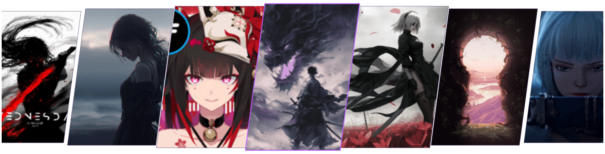
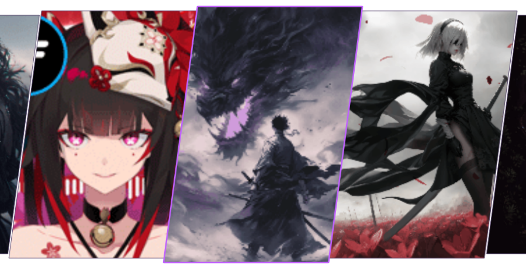

# Waywallen Selector

Un selector minimalista de wallpapers para **KDE Plasma y Waywallen**: tarjetas
diagonales en un carrusel flotante, sin panel, botones ni textos sobre las imágenes.

## Capturas

### Vista general



### Detalle de las tarjetas



Captura real del selector; la segunda imagen es un recorte de la primera.
Los wallpapers mostrados pertenecen a sus respectivos autores y no se distribuyen
como fondos instalables con el proyecto.

## Características

- Miniaturas estáticas de tu biblioteca existente, sin iniciar nuevos renderizadores.
- Fondos ordenados por fecha de incorporación: del más reciente al más antiguo.
- Al abrir, centra el último fondo aplicado desde el selector, aunque importes fondos nuevos.
- Navegación con teclado, rueda o arrastre; clic o Enter para aplicar.
- Transición nativa de Waywallen y opción interna de acento automático de Plasma.
- Paleta del wallpaper para KDE/Plasma, Dolphin/Kvantum, Kitty, Btop, Cava, bordes y Vesktop, con respaldo y restauración.
- Destino explícito por monitor: nunca se aplica un fondo a todas las pantallas por omisión.
- Ventana de tamaño fijo, compatible con el mosaico de Krohnkite sin recargarlo.
- Instancia única: el mismo atajo abre y cierra el selector.
- No queda ejecutándose después de cerrar la ventana.

Este proyecto es un complemento independiente; **no reemplaza Waywallen**.

## Compatibilidad

- Linux con KDE Plasma 6; comprobado en Wayland.
- **Waywallen 0.5.x o 0.6.x instalado mediante Flatpak** (`org.waywallen.waywallen`),
  con el daemon y la integración del escritorio funcionando.
- Biblioteca en `~/.var/app/org.waywallen.waywallen/data/waywallen/waywallen-v2.db`.
- Qt **6.8 o superior**, KDE Frameworks 6, CMake 3.24+, compilador C++20 y Protobuf.

La ruta de la biblioteca y el protocolo están adaptados a esa instalación de
Waywallen. Otras versiones, instalaciones nativas y otros escritorios no están
soportados por esta versión. Las entradas ocultas o cuyos archivos faltan se omiten.
Se reconocen las fechas de incorporación de ambas versiones (`create_at` y `added_at`).
Las superficies de bloqueo de pantalla no se ofrecen como destinos.

## Compilar e instalar

Dependencias orientativas en Arch Linux/CachyOS:

```bash
sudo pacman -S --needed base-devel cmake qt6-base qt6-declarative qt6-websockets qt6-wayland kconfig protobuf python python-pillow
```

Clona el repositorio y compila:

```bash
git clone https://github.com/riantorres1975/waywallen-selector.git
cd waywallen-selector
cmake -S . -B build -DCMAKE_BUILD_TYPE=Release -DCMAKE_INSTALL_PREFIX="$HOME/.local"
cmake --build build -j2
ctest --test-dir build --output-on-failure
cmake --install build
kbuildsycoca6 --noincremental
```

La instalación no necesita `sudo`: añade el ejecutable a `~/.local/bin` y los
lanzadores a `~/.local/share/applications` y `~/.local/share/kglobalaccel`.
No sobrescribe configuraciones de KWin, KDE, terminales o Waywallen.
Los archivos de una instalación anterior de **este selector** se reemplazan.
Los colores de las aplicaciones solo se modifican al confirmar un fondo con la
opción `automaticAppColors` activada.

Puedes probarlo sin instalar usando `build/waywallen-selector`.

## Uso

| Acción | Control |
|---|---|
| Abrir/cerrar | **Win + Alt + W** |
| Navegar | **← / →**, rueda vertical/horizontal, touchpad o arrastrar |
| Aplicar | **Clic en una imagen** o **Enter** |
| Cerrar sin cambiar el fondo | **Esc** |

Si el atajo no se registra inmediatamente, busca **Waywallen Selector** en
Preferencias del sistema → Teclado → Atajos y asígnale `Meta+Alt+W`.
No reemplaces otro atajo si esa combinación ya está ocupada.

La imagen elegida seguirá siendo un fondo animado cuando Waywallen lo reproduzca;
solo las miniaturas del carrusel son estáticas. El tamaño de la franja se adapta
a la pantalla, hasta 1800 × 460 píxeles lógicos.

La posición se recuerda por el ID del último wallpaper aplicado correctamente,
no por su número de tarjeta. Aparece directamente centrado, sin animar el recorrido
desde el inicio; la navegación conserva su animación. Navegar y salir con Esc no cambia ese recuerdo.
Si ya no está disponible, se centra el fondo actual de Waywallen; si tampoco está,
se muestran los más recientes. Abrir el selector no vuelve a aplicar el wallpaper.

## Preferencias internas

Se guardan en `~/.config/local.desktop/WaywallenSelector.conf`:

```ini
[appearance]
transition=1
automaticAccent=true
automaticAppColors=false
```

`transition`: `0` sin transición, `1` fundido, `2` barrido, `3` expansión.
La duración es de 500 ms. Estas opciones se aplican **solo al confirmar** un fondo.

`automaticAccent` activa el acento nativo de Plasma y la integración de Waywallen.
Por sí sola no cambia los temas de las aplicaciones. El acento es global:
Plasma decide qué pantalla usa para obtenerlo.
Poner esta preferencia en `false` evita activarlo; no desactiva una opción que ya
se hubiera habilitado en Plasma.

### Colores de las aplicaciones

Requiere **Python 3.10+, Pillow y Matugen 4.x** (`sudo pacman -S --needed python python-pillow matugen`).
Activa `automaticAppColors=true` en el archivo anterior, con el selector cerrado.

Al confirmar un wallpaper se toma su color de escena personalizado, si está definido
y no es gris. En los demás casos se extrae el acento cromático de la **miniatura**, sin
dejar que las zonas grises o los tonos de piel apagados dominen la elección.
Los fondos de las ventanas permanecen en **gris carbón**, sin el lavado marrón de
los neutros cálidos de Material You.

- **KDE/Plasma:** esquema nativo, selecciones, menús, bandeja, Andromeda y centro de control.
- **Dolphin/Kvantum:** variantes de Sweet-Blur con las mismas formas, transparencias y desenfoque.
- **Kitty:** fondo, texto, selección y acentos; conserva los colores de aviso rojo/verde/amarillo.
- **Btop:** tema `Waywallen`, sin reemplazar el tema original ni alterar la transparencia.
- **Cava:** degradado basado en la paleta, sin cambiar la captura de audio.
- **KWin:** bordes activos e inactivos y recarga inmediata del efecto Round Corners.
- **Vesktop Flatpak:** QuickCSS con acentos, texto, fondo y popups; conserva su opacidad.

Solo se ajustan las aplicaciones que ya tengan configuración compatible. No se
cambian fuentes, geometría, atajos, BTree, iconos ni los logotipos de las aplicaciones.
Plasma y Kvantum usan copias locales alternas de los temas instalados; los originales
no se modifican. Alternar las copias evita que se reutilicen imágenes con colores viejos.
Con esta opción activa, el esquema generado es la única fuente del acento: no compite
con la extracción automática nativa de Plasma.

La actualización avisa a KDE y al efecto de bordes por sus interfaces de recarga.
Dolphin recrea su estilo Kvantum en vivo, sin cerrar sus ventanas ni cambiar el estilo
global de las demás aplicaciones. Kitty, Btop y Cava reciben su señal de recarga si
la admiten; Vesktop conserva la recarga habitual de QuickCSS.
No se reinician aplicaciones, Plasma, KWin ni Krohnkite.

La generación sucede **una vez al elegir el fondo**, no al recorrer las tarjetas.
No hay un servicio vigilando cambios: los fondos cambiados fuera del selector no
actualizan estos colores. En vídeos/escenas se utiliza la miniatura, no cada fotograma.

Los archivos originales quedan en
`~/.local/state/waywallen-selector/colors/backup.json` (o bajo `$XDG_STATE_HOME`).
Para restaurarlos y desactivar esta opción:

```bash
waywallen-selector --restore-colors
```

La restauración conserva los ajustes ajenos a los colores y se detiene si un color
administrado fue editado después, para no perder cambios nuevos.
Si Matugen falla, el wallpaper se conserva y el selector
muestra el error sin cerrarse automáticamente.

Para revisar la paleta y los archivos previstos sin modificarlos:

```bash
python3 tools/color_sync.py --image /ruta/a/miniatura.png --dry-run
```

## Comprobaciones sin cambiar el fondo

```bash
build/waywallen-selector --diagnose
build/waywallen-selector --capture /ruta/a/preview.png
```

`--diagnose` consulta la biblioteca, los monitores y la compatibilidad del protocolo.
`--capture` guarda **solo la ventana del selector** y sale. Ambos modos impiden
aplicar wallpapers, incluso si se pulsa Enter o se hace clic en una tarjeta.
La captura puede contener imágenes de tu biblioteca: revísala antes de compartirla.

## Cómo funciona

La biblioteca SQLite se abre en **solo lectura**. El puerto de control del daemon
se obtiene mediante D-Bus y las operaciones se envían por su WebSocket local.
La interfaz se limita al subconjunto compatible del protocolo de Waywallen 0.5.x/0.6.x.

Antes de ajustar la transición se consulta la configuración completa: los campos
globales no modelados y las opciones de los plugins se preservan en protobuf.
No se edita `config.toml` mientras el daemon está ejecutándose. Los ajustes de
sonido, FPS y pausa automática siguen perteneciendo a Waywallen.

No se instalan extensiones ni se modifican permisos de Flatpak. El repositorio
no contiene fondos, credenciales, bases de datos, configuraciones personales ni
archivos compilados.

## Licencia

**GPL-3.0-only**. El esquema de protocolo deriva del proyecto Waywallen;
consulta [THIRD_PARTY.md](THIRD_PARTY.md) y [LICENSE](LICENSE).
